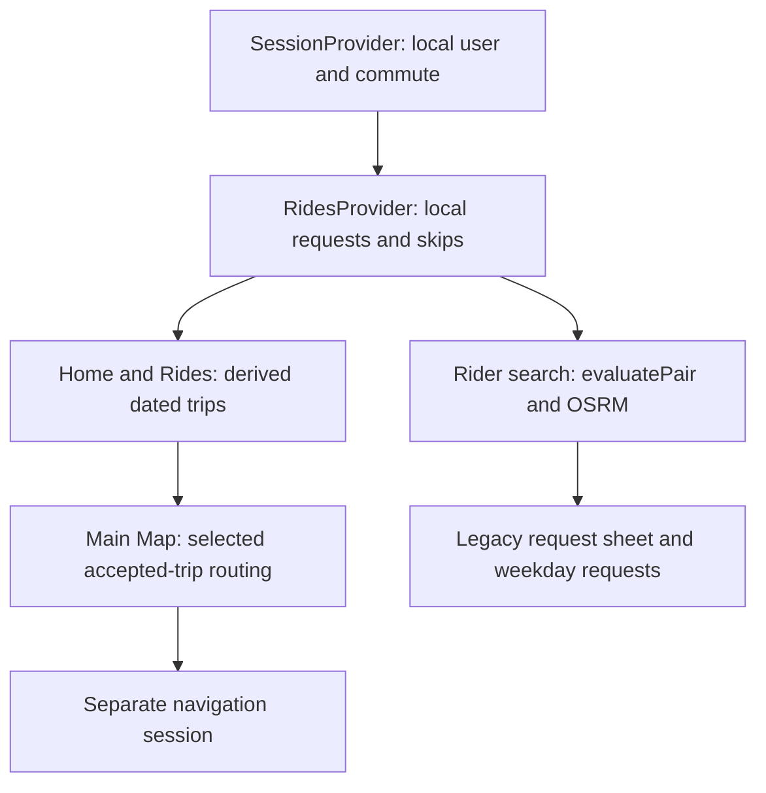

# Seawolf Rides: source review and integration plan

Reviewed October 15, 2026, from the uploaded `app.config.zip`, with a dependency/build follow-up using the subsequently supplied `package.json`, `package-lock.json`, and `scripts.zip`.

## Main conclusion

The project has useful routing and matching foundations. It is still a single-device prototype, and the largest problem is that its newer dated matching model and older recurring request model do not preserve the same agreed trip information. That explains much of the confusing behavior observed during testing.

The next implementation should preserve one evaluated plan through request creation, acceptance, trip display, and pickup routing. Adding more demo screens or another navigation provider should wait.

No application source was edited during this review. The archives were extracted into a separate review directory. Temporary test infrastructure and diagnostic probes were created outside the extracted application; supplied manifests and scripts were added unchanged. Dependencies were installed only in this review copy.

## 1. Scope and verification limits

The original ZIP contains 219 entries, including `src`, `test`, `plugins`, `AGENTS.md`, Expo/TypeScript/lint configuration, the routing guide, and the matching research plan. The later uploads supply the package manifests and the project's test-loader scripts.

Assets, backend/security-rule files, and repository Git metadata are still absent. Native compilation, device behavior, server authorization, and the actual checkout/branch status cannot be verified from this snapshot.

The exact declared Node **24.21.0** runtime was obtained for the final checks. Clean installation used npm **11.6.2**. The manifest pins Node but does not declare a `packageManager` version. The package and lockfile root dependencies agree.

| Check | Observed result | Limit |
|---|---|---|
| Clean dependency installation | Passed; 914 packages installed | `npm ci --ignore-scripts`; package lifecycle scripts and native builds were not run |
| Actual project test loader | **153 of 154 passed** | One asset-existence test fails because `assets/icon.png` was not uploaded |
| TypeScript | Passed | `tsc --noEmit` under Node 24.21.0 |
| Full configured Expo lint | Passed | No application lint findings |
| Android Expo export | Passed; 1,608 modules bundled | JavaScript/Hermes export, not an installable native app |
| Expo package-version check | Six patch-version mismatches | Detailed below |
| Expo Doctor | 18/21 checks passed | Missing uploaded assets, Google SDK directory metadata warning, and the patch mismatches |
| Dependency audit | 38 reported vulnerabilities | 11 moderate, 26 high, 1 critical; exploit reachability was not established |

The asset failure does not establish a defect in the user's original checkout. It also means the complete test command is not green in the supplied review copy. A successful Android export does not establish native SDK compatibility or device behavior.

No physical-device or emulator session was available. No fresh live OSRM request was used for the findings below; route-order reproductions use explicit deterministic adapter responses. The older October 6 project-breakdown file was treated as historical context, not as authoritative current implementation.

The initial partial review used Node 24.19.0 with a temporary resolver and had two missing-content test failures. The results above supersede that partial verification: the supplied manifest fixed one failure, and the project's own resolver now runs the tests under the pinned runtime.

## 2. What the application actually is

### Authentication and ownership

`src/auth/authService.ts` simulates latency and returns local user objects. Email sign-in does not check a password with a server, and Google sign-in returns the fixed Wolfie email. `SessionProvider.tsx` keeps user, profile, and commute in React state.

Returning users receive `demoProfileFor()` and `demoCommute`. The demo profile is `role: 'both'`, with riding on Monday/Wednesday/Friday and driving on Tuesday/Thursday. The greeting comes from the email-derived first name. It is not an authenticated driver identity maintained by a backend.

`RidesProvider.tsx` initializes sample requests and keeps them in memory. Initially only Maya is accepted in `demoIncoming`; Chris and Nia begin pending and can be accepted locally. Thus a screen displaying three accepted riders represents the current local session state, not proof of three server-backed acceptances.

Firebase initialization exists, and `sampleCommuteRepository.ts` can read one sample document. No application caller of `fetchSampleCommute` was found. No operational Firebase Authentication, persisted request writes, real-time ride synchronization, or real message delivery was found in the uploaded source.

`ConversationScreen.tsx` appends messages to screen-local state. Reloading loses the session and request state; leaving/remounting a conversation loses its local messages.

### Commute model

`src/commute/commuteModel.ts` stores a coarse privacy area, a campus destination, weekly day modes, arrival/departure clock minutes, and passenger-seat capacity. It intentionally does not store an exact home.

The older `Trip` model in `rideModel.ts` uses a **date-only ID** and combines inbound arrival and outbound departure in one record. Requests use weekdays. The newer evaluator uses a **date plus direction** and exact epoch-second windows. These representations are not yet unified.

### Runtime responsibilities



The architecture separates many pure calculations from screens, which is valuable. However, shared behavior is spread across several adjacent models, and `MapScreen.tsx` now has roughly 750 lines combining endpoint editing, geocoding, GPS, trip routing, native navigation availability, preview sessions, map expansion, and developer controls.

## 3. The different map/matching experiences

| Experience | Inputs and behavior | Connection to normal ride state |
|---|---|---|
| Main Map, standalone route | Start/destination selected by search, map, presets, or development Queens button | Calculates a route; does not select riders or accept requests |
| Dated rider search from Home | Explicit pickup point/windows/walking/seats, synthetic driver profiles, live OSRM, `evaluatePair` | Results open the old recurring request sheet; critical plan information is lost |
| Carpool Matching Demo | Two deterministic cases; optional live OSRM; one driver versus individual synthetic riders | Presentation/testing only |
| Queens Test as driver | Editable synthetic Queens driver and five synthetic riders, live road estimates | Development-only; no request mutations |
| Accepted-trip pickup route | Details opens Map with trip ID/date/direction; accepted local riders become stops | Connected to current local `RidesProvider`, but not a real backend |
| OSRM basic navigation | GPS from actual device, maneuver data, foreground progress/rerouting | Separate navigation state; does not complete or mutate the ride |
| Google navigation | Native SDK screen with terms, guidance, ordered destinations | Separate session; native build and credentials still require verification |

The map's ordinary rider-area markers come from `getDemoRiderCandidates()` in `src/map/demoRiderCandidates.ts`. They are a separate fixed set, not ranked recommendations or a live view of accepted passengers. Candidate Maya in the Queens test and accepted-fixture Maya are not one unified person record.

The Queens button in the main Map changes only the actual route-planner start. It does not relocate the saved commute, alter the account role, reload recommendation profiles, or create an accepted pickup route. The driver test page and normal rider-search Queens override have separate state.

## 4. What is solid and worth retaining

- `evaluatePair.ts` uses explicit units, road travel times, pickup service, walking limits, seats, dated occurrences, and interval intersection. It distinguishes missing information from proven infeasibility.
- The active driver detour cap is the stricter of the absolute and percentage limits.
- The rider pickup window means ready at the pickup point, so access walking is not added twice. Egress walking is added to rider arrival in the pair evaluator.
- The OSRM adapter validates coordinates and provider payloads, parses road geometry and ordered maneuver legs, handles timeouts/cancellation, and does not use a straight-line fallback.
- Latest-request wrappers protect many result updates from superseded work.
- The presentation separates deterministic fixture estimates from live routing, and schematic geometry is labeled.
- The confirmed-trip Map route resolves current local data using stable IDs, checks that all accepted pickups are supplied, uses the trip's campus destination, and requires proposed-order confirmation.
- Map expansion and marker/card interaction are implemented rather than simply described in docs. Device behavior still needs testing.

The pair evaluator is **TO_CAMPUS only**. In the actual uploaded implementation, `FROM_CAMPUS` returns `UNKNOWN / UNSUPPORTED_DIRECTION`. It plans no pickup waiting. The multi-pickup schedule checker, by contrast, allows waiting until pickup-window opening. This is a real policy difference that should be explicit.

## 5. Confirmed integration findings, in priority order

### P1 — A recommendation's agreed plan is discarded when requesting

**Evidence:** `src/screens/DayDriversScreen.tsx:254`, `src/rides/components/RequestSheet.tsx`, `src/rides/RidesProvider.tsx:104`, `src/rides/rideModel.ts:46` and `:506`.

The rider enters a concrete date, public pickup coordinates, readiness/arrival windows, seats needed, and walking constraints. The evaluator returns exact recommended times. The request action nevertheless calls only `sendRequest(offerId, days)` and stores:

```ts
{ id, offerId, days, status }
```

The chosen pickup, occurrence date/direction, requested seat count, evaluation plan, and assumptions are not retained. The sheet shows `offer.pickupTime` and `offer.arriveBy`, not the evaluated plan, and lets the user select other weekdays that were not evaluated. `getUpcoming()` later reconstructs the ride using the original offer fields.

**Reproduced:** With a valid deterministic road adapter and Alex's current routing profile, the normal evaluator returned FEASIBLE for October 16, with pickup **08:05**, campus arrival **08:31**, a custom selected public point, and **two seats requested**. A request in the actual stored shape generated accepted trips for both **October 16 and October 23**, displaying Alex's old **07:55 pickup**, **08:40 arrival**, and **Smith Haven Mall** pickup description.

**Impact:** What the user agrees to can differ from the recommendation. A one-date feasibility result can be treated as recurring coverage. Seat and location consent cannot be enforced from the stored request.

**Fix direction:** Preserve an occurrence-specific, versioned evaluated proposal across request creation and acceptance. Recurrence should be an explicit operation producing separately evaluated occurrences or a clearly defined series contract. The request sheet, accepted trip, and Map must consume the same proposal.

### P1 — Capacity is a UI gate, not an acceptance invariant

**Evidence:** `src/rides/rideModel.ts:323` versus `src/rides/RidesProvider.tsx:174` and `:126`.

`canAccept()` checks shared-day role conflicts and full capacity. The incoming-request UI disables acceptance based on these helper results. But `respondToRequest()` itself checks only accepted outgoing commitments; it does not call the capacity check before changing status.

The outgoing simulated response similarly checks a driving conflict and accepts after five seconds without validating route feasibility, current offer capacity, or a competing outgoing accepted driver. Offer `seatsLeft` is fixed fixture data and is not decremented by acceptance. `seatsTaken()` counts request records, not `seatsRequested`.

**Evidence level:** Confirmed by direct source tracing; React provider interactions were not executed on a mounted device in this review. Current tests exercise model helpers rather than proving acceptance mutations are atomic.

**Fix direction:** Put validation in one authoritative acceptance operation. Check the current occurrence, pending status, duplicate/commitment constraints, seat quantities, plan version, and feasibility before mutation. When backend work begins, make seat reservation and acceptance transactional.

### P1 — The pickup planner can overlook a feasible order

**Evidence:** `src/routing/tripPickupRoute.ts:109` and `:142`.

The planner compares all bounded pickup orders using road duration, returns only the shortest, and then the screen validates that one order's schedule. It does not filter orders by schedule first.

**Reproduced with two accepted riders:**

| Order | Road duration | Schedule result |
|---|---:|---|
| A then B | 30 minutes | CONFLICT: B is picked up too late |
| B then A | 35 minutes | VERIFIED by current checker |

The algorithm returned A then B and the conflicting result, despite calculating the alternative route that fits. B's pickup window was 08:00–08:10; departure was 08:00. A-first reached B at 08:25; B-first reached B at 08:05.

**Fix direction:** Validate each order, choose the best fully feasible order, and show a separate incomplete result if required data is missing. If no feasible order exists, explain the actual conflicts. Rank the feasible set by a documented criterion; shortest road time and lowest elapsed time including waiting are different policies.

### P1/P2 — “Schedule verified” checks a narrower contract than matching

**Evidence:** `src/routing/tripPickupRoute.ts:142`, `src/rides/rideModel.ts`, `src/screens/MapScreen.tsx`.

The accepted-route checker validates pickup windows, explicit service duration, driver campus deadline, and each rider's deadline against the common **vehicle campus arrival**. It does not check:

- Walking from that common drop-off to each rider's destination.
- Whether different campus destinations were mutually agreed to share one drop-off.
- Multi-rider in-vehicle detour limits.
- Driver total added elapsed time including waiting versus a solo baseline.
- Driver departure flexibility or an acceptance-time capacity invariant.

Maya's fixture campus destination is West Side, Chris's is Roth, and the shown driver trip goes to Tabler. No corresponding per-rider egress data exists in `TripPickupStop`. Therefore passing this checker is not equivalent to satisfying every matching constraint.

**Fix direction:** Label this as the exact fixed-order pickup/deadline check until the complete contract exists. Carry destination semantics, service, walking, waiting, capacity, and limits in the agreed proposal, and revalidate the combined plan. Missing values should remain unknown rather than imply zero.

### P2 — Skipped and stale selected trips need stronger handling

**Evidence:** `src/routing/tripPickupRoute.ts:38`, `src/app/(tabs)/map/index.tsx:27`, `src/screens/MapScreen.tsx`.

`resolveTripPickupSelection()` accepts a skipped driving trip. A separate probe confirmed that a record with `skipped: true` is still returned. The Details button is hidden for skipped trips, but a previously opened Map or direct route parameters should also be invalidated.

Map's remount key omits skip state and some scheduling fields, such as the driver's `arriveBy`. A failed lookup of an explicitly requested trip falls back to ordinary/current-trip behavior rather than clearly saying that the selected trip is no longer available. DayDriversScreen cancels on unmount or form edits but has no general invalidation effect for changing commute/request/skip props.

**Fix direction:** Use an occurrence/plan revision in result ownership, invalidate on all relevant changes, and show an unavailable state for an explicit invalid trip selection. Do not silently repurpose it into a standalone route.

## 6. Additional issues and limits

### Input robustness is weaker than earlier summaries claimed

`evaluatePair(undefined)`, `evaluatePair({})`, and an otherwise valid input with `driver: undefined` all throw `TypeError`. The implementation destructures and reads the driver before guarding the outer shape. Many individual malformed fields are handled correctly, but the claim that all omitted runtime inputs return structured UNKNOWN results is not true for this archive.

Add a runtime boundary validator before destructuring if this will accept persisted/network data. Keep the pure typed function contract explicit.

### Timezone handling is inconsistent across the old and new models

The normal matching converter explicitly uses America/New_York. `getUpcoming()`, `dateKeyOf()`, and the home clock use device-local dates/times. Traveling or changing device timezone can produce different date semantics.

A probe for New York **2026-03-08 02:30**, a nonexistent spring-forward time, returned **03:30** without an error. Ambiguous fall-back times also need an explicit policy. Ordinary January and July conversion tests pass; transition cases are not covered by those tests.

### Navigation uses a new live origin, not the preview's test origin

Both navigation paths obtain actual current device location and recalculate. Selecting Queens for a preview does not simulate being in Queens during navigation. A pickup schedule validated from Jamaica at 06:45 can therefore describe a different trip from the subsequently launched live navigation session.

The navigation request includes ordered coordinates and a ride ID but no validated plan version, departure contract, pickup windows, or service durations. Navigation does not re-resolve the trip from `RidesProvider`, so a cancellation or pickup update after launch is not automatically revalidated there.

### Precise coordinates still appear in navigation URL parameters

Details-to-Map navigation passes only IDs/date/direction, as requested. Map-to-navigation calls `encodeRouteNavigationRequest()`, which JSON-serializes precise waypoint coordinates into Expo Router parameters. This is acceptable only as clearly understood synthetic prototype behavior; it is not an authorization mechanism for real data. Resolve an authorized plan/session by ID for real-user navigation.

### Basic navigation is custom foreground guidance

`BasicNavigationScreen.tsx` sets camera `heading: 0`, so it recenters with a fixed north-up bearing rather than orienting to the driver's direction of travel. The marker displays the raw current fix. The progress projection is not a production road-network map-matching SDK.

Remaining time is route duration multiplied by remaining-distance fraction, not the sum of future leg/step travel times or a traffic prediction. Intermediate stops advance with geometric leg progress rather than a confirmed passenger-boarded action. The screen has no voice guidance.

The simulation and pure progress tests are useful, but do not verify real permission behavior, app lifecycle, road noise, bridge rendering, or actual multi-stop navigation. Resume/start/end races should also be tested at the hook/device level; helper resource-slot tests alone do not establish those properties.

### Synthetic data is not confined to development routes

Development pages have production redirects, but the main app still initializes demo requests and synthetic profiles without a production data boundary. Ordinary Map calls `getDemoRiderCandidates()` unconditionally. Hiding demo buttons does not transform the remaining app into a real-user platform.

Also, imported Google native configuration is applied independent of which navigation button is visible. Do not assume unused native dependencies disappear just because a screen is hidden. The follow-up verifies dependency resolution and Android JavaScript export, but not native compilation or SDK operation on a device.

### Minor defensive and UX improvements

- `RiderDemoEvaluation`'s malformed-leg branch retains cloned fixture travel values instead of explicitly replacing candidate estimates with missing. The current OSRM adapter normally rejects malformed legs first, but an alternative adapter could produce a misleading evaluation in that branch.
- Main Map still combines standalone planning, preview-session start, two navigation paths, accepted routing, and demo entry points. Prefer explicit modes and context labels; avoid treating all of these as “Start ride.”
- The legacy `OfferDetailScreen` route still calls `matchDrivers` and can request recurring days without the newer dated evaluator. This is another bypass to migrate or clearly limit.
- Main recommendation UI asks the rider to type walking durations/limits and an extra ride limit that is nondiscriminating in the direct one-pickup model. These are prototype assumptions, not measured walking routes.
- Full-screen expansion code is repeated between the main Map and reusable comparison map. Consolidate it after behavior stabilizes.
- Public OSRM and Photon defaults are demonstrator infrastructure. Service configuration, usage policy, reliability, and production deployment remain separate work.

## 7. What to keep, consolidate, and postpone

### Keep

- The pair evaluator, reason codes, explicit units, and focused tests.
- The OSRM/geocoding adapters and latest-request patterns.
- Confirmed-trip-to-Map entry and numbered accepted pickups.
- The compact two-case presentation demo.
- Privacy-area versus selected-point distinction.
- Full-screen maps.

### Consolidate

- Put all synthetic presets and diagnostic screens behind one developer area.
- Keep Queens as one optional start preset, not separate overlapping definitions of the signed-in driver.
- Make driver/rider discovery share data contracts and reusable evaluation orchestration instead of making production logic depend on demo-named types.
- Reduce direct fixture imports in normal screens by introducing repository/provider interfaces.
- Remove stale comments claiming no fixture coordinates now exist.
- Preserve unit tests; reducing visible debug UI is not a reason to delete useful test coverage.

### Postpone

- Further Google/Mapbox/provider migrations until the existing ride contract is coherent.
- Advanced voice/background navigation unless required for the milestone.
- Large-scale route optimization; bounded enumeration for a few riders is sufficient while correctness is established.
- Real precise-location sharing before authentication, persistence, and server authorization exist.

## 8. Recommended next milestones

### A. Preserve a dated evaluated proposal end to end

Create a shared contract containing occurrence ID/date/direction/timezone, participant and offer IDs, requested seats, confirmed meeting point, common vehicle destination and rider destination semantics, explicit windows/limits, service/walking assumptions, evaluated times, route metadata, and a plan revision.

The record should distinguish user-confirmed facts from provider estimates. Not every derived geometry needs to be persisted. For the current prototype, preserve the contract in local state first without claiming backend security.

Update the request sheet to show the actual proposed date, pickup, seats, and calculated times. Do not imply an unevaluated return trip or other weekdays are validated. Accepted trips and Map should read the same record, not reconstruct it from `DriverOffer` defaults.

Acceptance must validate current state and the proposal revision. Existing recurrence can remain supported through explicit migration rather than silently interpreting a dated result as a weekly series.

### B. Enforce acceptance invariants

Centralize status transition, duplicate/conflict checks, seat quantities, schedule/route revalidation, and cancellation handling in the provider/service layer. UI gating can reflect the operation's result but cannot replace it.

### C. Select among schedule-feasible combined orders

Evaluate all bounded orders against the full confirmed contract. Choose a feasible order according to the declared policy, and document the no-wait versus waiting behavior. Expose incomplete inputs and conflicts without removing accepted passengers.

### D. Consolidate presentation and test tools

Once A–C work, simplify navigation to three clear product intents: Find a carpool, My accepted trip, and Plan a standalone route. Keep one developer area and one concise M3 demonstration.

### E. Add the real multi-user boundary

Implement real authentication, persistent candidate/occurrence/request/plan records, authorized precise-pickup access, transactional seats, and participant cancellation updates. These require backend/rules work absent from the supplied ZIP.

## 9. The acceptance test that matters most

Use two separate explicit app roles or a controlled prototype session and follow one scenario:

1. Rider selects a dated inbound trip, public pickup, windows, and two seats.
2. Search returns a feasible plan with concrete times.
3. Request sheet displays those exact agreed facts.
4. Request record retains them.
5. Driver accepts only if capacity/conflicts/plan version remain valid.
6. Accepted trip Details shows the same pickup/date/seats/times.
7. View pickup route includes that pickup and every previously accepted rider.
8. A second conflicting acceptance is rejected.
9. Changing/cancelling a pickup invalidates the old route and navigation authorization.
10. A reload behaves according to the declared storage mode: reset for the prototype, restored for a future persistent implementation.

Passing more disconnected helper tests is not a substitute for this chain.

## 10. Next Codex prompt

```text
Read the source review before editing. Focus only on preserving the evaluated
dated proposal through the normal rider-search request flow.

Inspect driverRecommendations, DayDriversScreen, RequestSheet, RidesProvider,
rideModel/getUpcoming, TripDetailScreen, and tripPickupRoute.

The confirmed bug is that DayDriversScreen evaluates a date, selected pickup,
two possible seats, and exact times, but sends only offerId + recurring days.
The accepted trip then reverts to DriverOffer pickupTime/arriveBy/pickupSpot.

Introduce an explicit versioned dated proposal contract and preserve it through
request creation, local acceptance, accepted trip display, and selected-trip
Map routing. Show the evaluated date/pickup/seats/times in the request sheet.
Do not apply one date's successful evaluation to other weekdays or return trips.
Define compatibility behavior for existing seeded recurring requests.

Centralize acceptance validation in the state/service mutation itself:
current pending status, exact occurrence, duplicates/conflicts, requested seats,
available seats, and proposal freshness. Do not rely on disabled UI buttons.
Keep the current local prototype explicitly labeled; do not claim backend
authorization or cross-device atomicity without implementing that backend.

Preserve the main Map, pickup routes, demos, and unrelated working-tree changes.
Add regression tests for the actual search → request → accepted trip → Map
handoff and for two requests competing for the last seat. Test that matched
pickup/time/seats do not revert to fixture defaults after acceptance.

Use the pinned runtime and run typecheck, lint, full tests, and export.
Report exact phone steps, the new request shape, compatibility limitations,
and checks actually performed. No new demo screens or provider migrations.
Do not commit, push, merge, or switch branches.
```

## 11. Dependency and build follow-up

### Manifest and test setup

The supplied manifest uses Expo **57.0.25**, React Native **0.86.3**, React **19.2.3**, Google Navigation SDK **0.16.3**, and react-native-maps **1.27.2**. The Expo 57 documentation lists React Native 0.86 and React 19.2.3 as its baseline; there is no evidence here of a mismatched React/RN major version. See [the versioned Expo SDK 57 documentation](https://docs.expo.dev/versions/v57.0.0/).

The tests use Node's built-in test runner, not Jest. The actual command is:

```sh
node --import ./scripts/node-test/register-ts-resolver.mjs --test
```

The supplied resolver retries extensionless relative imports with `.ts`. It ran successfully under Node 24.21.0. Adding `"type": "module"` solely to silence warnings would need care because the Expo config, ESLint config, and native plugin currently use CommonJS.

The `web` script exists, but `react-native-web` is not a declared root dependency. Android export success should not be presented as verified web support. The `android` and `ios` scripts start the Expo development server; they do not compile a development client.

### Expo patch alignment

The read-only Expo version check recommended these versions on October 15, 2026:

| Package | Installed | Recommended range |
|---|---|---|
| expo | 57.0.25 | ~57.0.30 |
| expo-constants | 57.0.19 | ~57.0.22 |
| expo-dev-client | 57.0.19 | ~57.0.20 |
| expo-linking | 57.0.11 | ~57.0.13 |
| expo-location | 57.0.20 | ~57.0.21 |
| expo-router | 57.0.23 | ~57.0.28 |

Review these as a small, separate dependency-maintenance change using Expo's installer, with a lockfile diff and the existing checks. No dependency versions were changed during this review.

Expo Doctor also reports React Native Directory metadata flagging `@googlemaps/react-native-navigation-sdk` as unsupported on the New Architecture. That metadata warning is not proof that this particular integration cannot compile, and successful JavaScript export is not proof that it can. An actual Android/iOS native build and device navigation test are still needed. Suppressing the metadata warning would not perform those checks.

### Dependency audit

The audit reproduced **38** vulnerable dependency entries: **11 moderate, 26 high, 1 critical**. The count includes transitive packages and packages affected through dependency chains. It is not 38 demonstrated vulnerabilities in the phone's ride flow.

The critical entry is **shell-quote 1.10.0**, installed through `react-native → react-devtools-core → shell-quote`. The [reviewed advisory GHSA-pqg4-j6r4-53mv](https://github.com/advisories/GHSA-pqg4-j6r4-53mv) lists **1.11.0** as patched. The advisory requires particular attacker-controlled input reaching a shell-quoting call; this review did not establish such a path in the app. A targeted compatible dependency/lockfile update is justified, followed by the normal checks.

Other entries include build-tool dependencies, the Expo tunnel helper, and a Firestore/gRPC chain. Their runtime versus development reachability needs separate triage. The audit's `--force` fix suggestions include downgrading Expo to 44.0.6, React Native to 0.72.17, and Firebase to 9.14.0. Applying those wholesale would undo the project's current platform choices. Do not use `npm audit fix --force` as a cleanup shortcut.

### What remains unavailable

The missing `assets` folder is sufficient to explain the remaining test and Expo asset-schema failure in this snapshot. It is not necessary to re-upload source merely to continue the integration fixes described above. Assets and any EAS configuration would be needed for a complete native configuration review. Backend functions and security rules require separate review if they live outside `mobile`.

Keep `.env`, credentials, signing files, `node_modules`, and generated build folders out of uploads.
